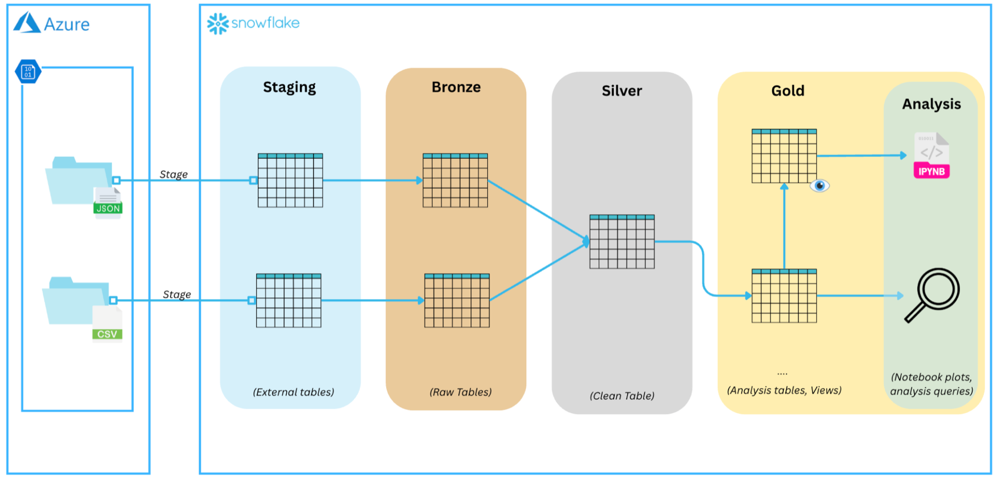
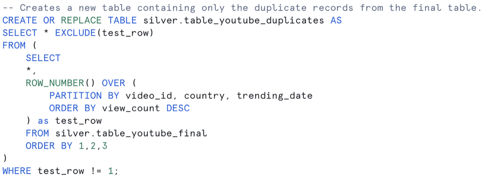
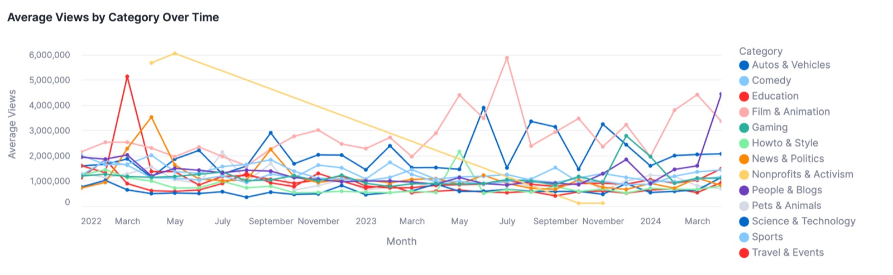
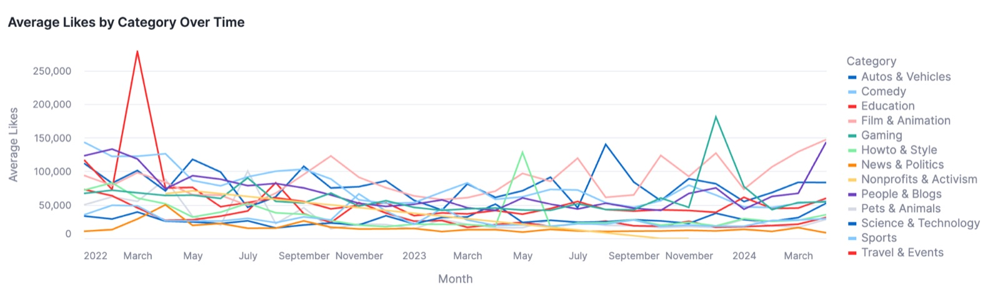
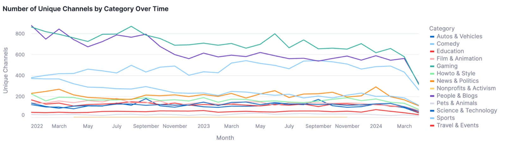
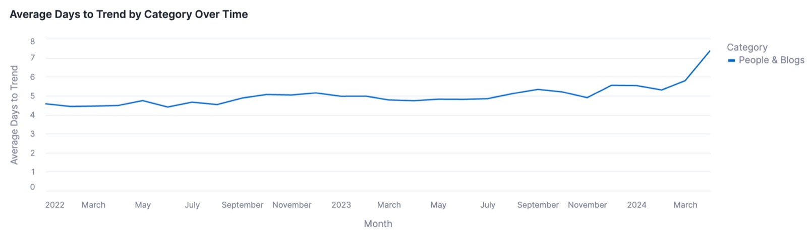
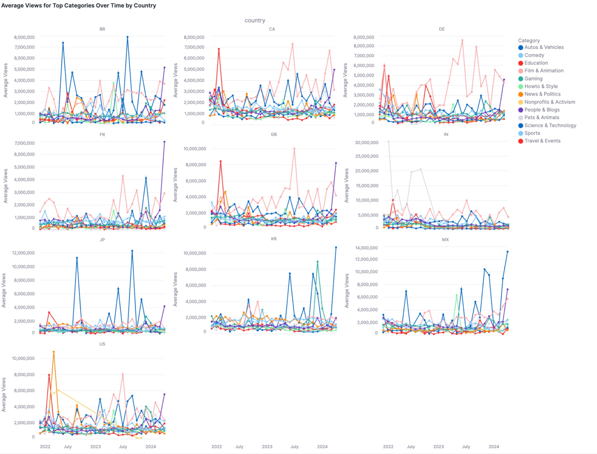
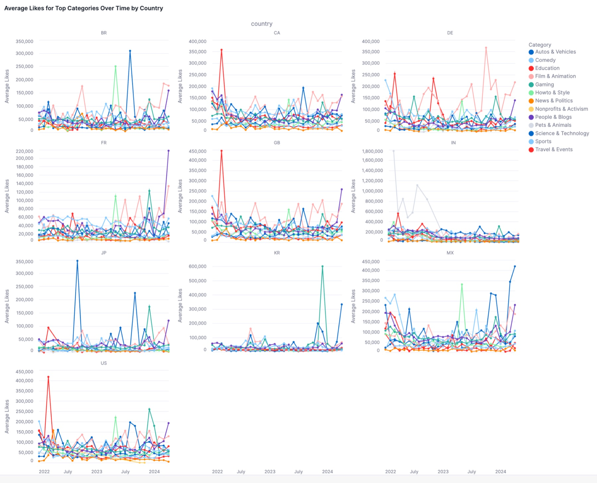

# YouTube Trending: a Medallion Lakehouse on Snowflake

An end-to-end ELT pipeline that lands four years of daily YouTube trending data from Azure Blob Storage into **Snowflake**, refines it through **Bronze, Silver and Gold** schemas, and answers a strategy question: *if you launched a channel tomorrow, which category would get you into the top trending list?*

## The data

Daily snapshots of the top-200 trending videos in ten regions (IN, US, GB, DE, CA, FR, BR, MX, KR, JP) from **12 August 2020 to 15 April 2024**, published on [Kaggle](https://www.kaggle.com/rsrishav/youtube-trending-video-dataset). Each region ships a CSV of trending videos and a JSON file mapping its `category_id` values to titles.

## Pipeline

| Layer | Objects | What happens |
|---|---|---|
| **Staging** | 2 stages, 2 file formats, 2 external tables | Snowflake stages connect to the Azure container with a SAS token; external tables read the CSV and JSON files in place. |
| **Bronze** | `bronze.table_youtube_trending`, `bronze.table_youtube_category` | First typed, physical copy of the data inside Snowflake. |
| **Silver** | `silver.table_youtube_final`, `silver.table_youtube_duplicates` | Trending and category tables joined on country and category id, a UUID added, then nine data-quality checks and fixes. |
| **Gold** | `gold.table_youtube_final`, analysis tables and `v_yt_global_*` / `v_yt_country_*` views | Business questions answered with window functions and aggregations ready for the notebook. |

The SQL is split by layer in [`sql/`](sql/):

| File | Contents |
|---|---|
| `01_staging_and_bronze.sql` | Database, schemas, stages, file formats, external tables and the two Bronze tables |
| `02_silver_data_quality.sql` | The Silver join and the data-quality investigation |
| `03_gold_business_questions.sql` | Gold table and the five business questions |
| `04_gold_strategy_analysis.sql` | Global and per-country analysis tables and views for the channel strategy |

## Silver layer: data quality findings

| Check | Finding and action |
|---|---|
| Duplicate category titles across ids | `Comedy` appears under two ids |
| Category present in only one country | `Nonprofits & Activism` exists only in the US feed |
| Missing category titles | All belong to `category_id = 29`; **1,563 rows** updated to `Nonprofits & Activism` |
| Video without a channel title | *Kala Official Teaser \| Tovino Thomas \| Rohith V S* |
| Invalid video ids (`#NAME?`) | **32,081 rows** deleted |
| Exact duplicates per video, country and date | Isolated with `ROW_NUMBER()` into `table_youtube_duplicates`, then **37,466 rows** deleted |
| Final row count | **2,597,494** rows, verified |

## Gold layer: business questions

1. **Top 3 Gaming videos per country on 2024-04-01.** Clash Royale's *Dagger Duchess* trailer led in most regions with 4.9M views.
2. **Distinct videos mentioning "BTS" per country.** South Korea leads with 468, followed by India (288) and the US (268).
3. **Most-viewed video per country per month before 2024.** MrBeast and the League of Legends *Still Here* cinematic dominate January 2024, with 104M to 144M views.
4. **Dominant category per country before 2022.** `Entertainment` everywhere except Canada and the US, where `Gaming` leads (about 21% of trending videos).
5. **Most prolific channel.** Vijay Television, with 2,049 distinct trending videos.

## The strategy question

Excluding Music and Entertainment and looking at 2022 onwards, the global aggregates show which categories are growing, how crowded they are and how long a video takes to trend.

**Globally, People & Blogs is the strongest candidate.** Its average views and likes have risen steadily since early 2024. It is also the most competitive category, and a video now takes almost eight days to reach the trending list.

Breaking the same metrics down by country shows that one strategy does not fit all markets.

**Recommendation**

- For a global campaign aiming for the widest reach, **People & Blogs** is the most viable path despite the competition.
- For a country-specific strategy, lean on regional tastes: **Science & Technology** performs strongly in South Korea and Mexico, and **Film & Animation** in Germany, Canada and Great Britain.

The charts come from [`notebooks/analysis_plots.ipynb`](notebooks/analysis_plots.ipynb), which reads the Gold views with Plotly.

## Running it

1. Upload the Kaggle files to a blob container with two folders, `youtube_trending/` (CSV) and `youtube-category/` (JSON).
2. In `sql/01_staging_and_bronze.sql`, replace `<YOUR_AZURE_SAS_TOKEN>` and the container URL with your own.
3. Run the four SQL scripts in order in a Snowflake worksheet.
4. Point the notebook at your Snowflake account and run it to regenerate the plots.

## Report

The full write-up, including the data dictionaries and result tables, is in [`report/youtube_trending_lakehouse_report.pdf`](report/youtube_trending_lakehouse_report.pdf).

## Stack

Snowflake · Azure Blob Storage · SQL · Python · Plotly
